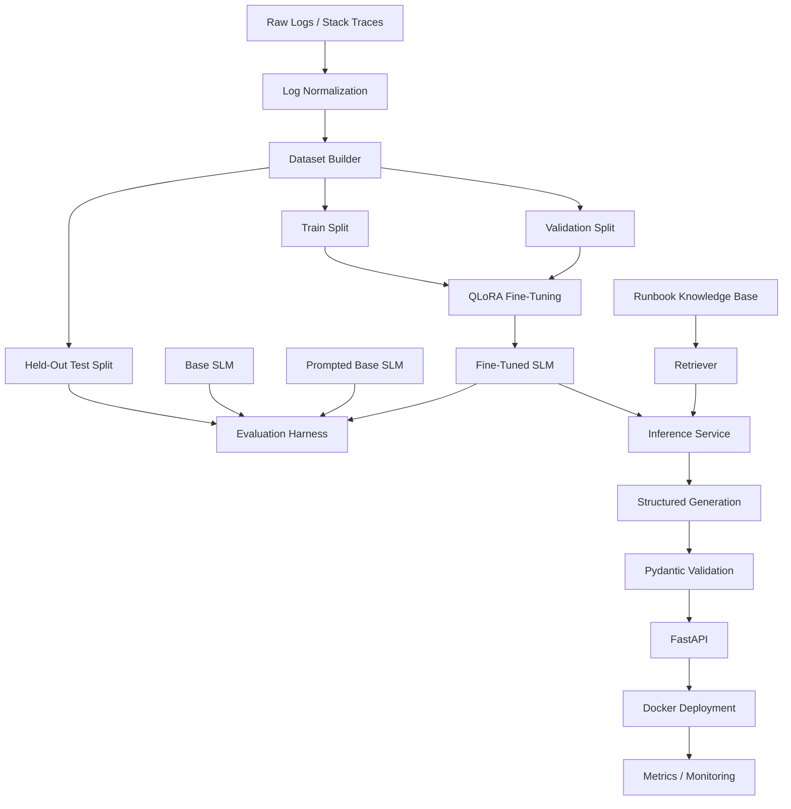
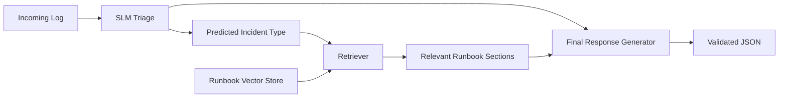
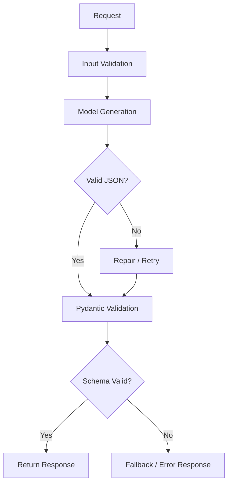
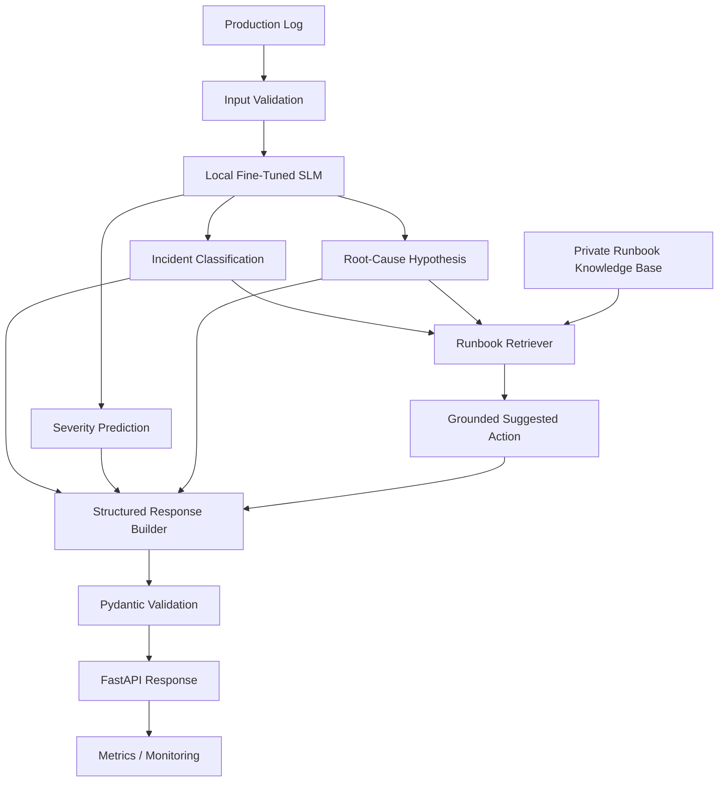

# LocalOps AI

## Production-Grade Private SLM for Log Triage, Root-Cause Analysis, and Runbook-Grounded Remediation

> **Purpose of this document**
> This is the upgraded implementation roadmap for the original **SLM Log Triage & Root Cause Analysis** project.
> The goal is not only to make the project work, but to make it strong enough to represent you as an **AI Engineer / ML Engineer / LLM Engineer** in a portfolio, technical interview, or GitHub review.

---

# 1. Why Build This Project?

Modern production systems generate huge quantities of logs from:

- APIs
- microservices
- databases
- Kubernetes
- message brokers
- authentication services
- proxies
- caches
- operating systems
- cloud infrastructure

When an incident occurs, an engineer may need to inspect many lines of logs before answering basic questions:

1. **What type of incident is this?**
2. **How severe is it?**
3. **Which service is affected?**
4. **What is the likely root cause?**
5. **What should we do next?**

Large cloud LLMs can help, but companies may not want to send private infrastructure logs to an external API.

This project therefore builds a **small local language model** that performs incident triage inside private infrastructure.

The final system should convert something like:

```text
CRITICAL [payment-api]
org.postgresql.util.PSQLException:
FATAL: remaining connection slots are reserved...
```

into a validated structure such as:

```json
{
  "incident_type": "DATABASE",
  "severity": "P1_CRITICAL",
  "affected_service": "payment-api",
  "root_cause": "PostgreSQL connection capacity has been exhausted.",
  "suggested_action": "Inspect the connection pool and database max_connections.",
  "confidence": 0.94
}
```

The important part is that this project is **not just about prompting an LLM**.

It demonstrates the complete engineering lifecycle:

```text
Data
  ↓
Dataset Engineering
  ↓
Baseline Evaluation
  ↓
Prompt Engineering
  ↓
QLoRA Fine-Tuning
  ↓
Structured Generation
  ↓
Evaluation
  ↓
RAG / Runbook Retrieval
  ↓
FastAPI Serving
  ↓
Docker
  ↓
Monitoring
  ↓
Production-Style Demo
```

---

# 2. What We Keep From the Original Project

The original project already has a strong foundation.

We keep:

- Qwen-family small language model
- Hugging Face Transformers
- PEFT / LoRA
- 4-bit QLoRA
- bitsandbytes NF4 quantization
- Pydantic schemas
- FastAPI
- Docker
- base model vs fine-tuned model comparison
- local/private inference
- GPU-conscious deployment
- incident classification
- severity prediction
- root-cause generation
- remediation recommendation

The biggest changes will be in:

1. dataset quality
2. train/test splitting
3. evaluation
4. structured generation
5. runbook grounding
6. production API design
7. observability
8. GitHub presentation

---

# 3. The Main Problem in the Original Plan

The original version generates a large dataset by repeatedly selecting from a very small incident corpus.

Conceptually:

```python
for _ in range(1500):
    item = random.choice(INCIDENT_CORPUS)
```

If the corpus contains only a few unique incidents, the resulting 1500 examples are mostly repetitions.

Then the data is shuffled and divided into training and test sets.

This creates a serious evaluation problem.

## Example

Imagine the source corpus contains:

```text
PostgreSQL connection exhaustion
Redis timeout
Java OutOfMemoryError
SQL injection
Brute force login
Disk pressure
External API timeout
```

If the same PostgreSQL log appears hundreds of times, some copies can enter the training set and other copies can enter the test set.

The model is therefore tested on something it has effectively already seen.

That is called **data leakage**.

A result such as:

```text
95% incident accuracy
93% severity accuracy
99% JSON validity
```

would look impressive but would not prove that the model generalizes to unseen incidents.

For a serious portfolio project, we want:

> **The test data must contain logs the model has never seen during fine-tuning.**

---

# 4. Upgraded Project Goal

The upgraded project will be called:

# LocalOps AI

### Suggested subtitle

**A Privacy-Preserving Small Language Model for Production Incident Triage and Runbook-Grounded Root-Cause Analysis**

The project should answer this engineering question:

> Can a compact locally hosted SLM be fine-tuned to reliably transform heterogeneous production logs into structured incident intelligence while maintaining low latency and high schema compliance?

---

# 5. Target System Architecture



---

# 6. The Five Core Layers

The project should be understood as five major engineering layers.

---

## Layer 1 — Dataset Engineering

This is one of the most important parts of the whole project.

### Objective

Build a diverse dataset of realistic production incidents.

Instead of seven repeated examples, create **incident families**.

Example families:

### Database

- PostgreSQL connection exhaustion
- deadlocks
- replication lag
- slow query
- disk-full errors
- transaction timeout
- authentication failure

### Infrastructure

- Kubernetes OOMKilled
- CPU saturation
- memory pressure
- disk pressure
- pod crash loops
- node unavailable
- DNS failures
- container image pull errors

### Application

- HTTP 500
- dependency timeout
- null pointer / runtime exceptions
- thread pool exhaustion
- failed downstream API calls
- retry storms
- malformed payloads

### Security

- brute-force authentication
- SQL injection attempts
- suspicious API tokens
- authorization failures
- repeated forbidden requests
- unusual IP activity
- credential abuse

### Messaging / Streaming

- Kafka broker unavailable
- consumer lag
- partition errors
- queue backlog
- Redis stream timeout
- RabbitMQ connection errors

### Networking

- DNS resolution failure
- TLS certificate expiration
- connection reset
- socket timeout
- refused connection
- packet-loss symptoms

---

# 7. Dataset Design

Each record should contain both the raw log and ground-truth labels.

Example:

```JSON
{
  "incident_id": "db_conn_0041",
  "family": "postgres_connection_exhaustion",
  "raw_log": "CRITICAL [checkout-api] PostgreSQL FATAL: remaining connection slots...",
  "incident_type": "DATABASE",
  "severity": "P1_CRITICAL",
  "affected_service": "checkout-api",
  "root_cause": "Database connection capacity is exhausted.",
  "suggested_action": "Inspect pool usage, PgBouncer, and max_connections."
}
```

---

# 8. Generate Variation Correctly

Synthetic data is acceptable for a portfolio project, but the variation must be meaningful.

For each incident family, vary:

- service name
- timestamps
- IP addresses
- ports
- request IDs
- namespaces
- pod names
- hostnames
- stack traces
- error wording
- memory limits
- timeout durations
- database names
- HTTP status codes
- cloud/container environment

Example:

### Same incident family

```text
payment-api → PostgreSQL max connections reached
```

```text
checkout-service → HikariPool unable to obtain JDBC connection
```

```text
orders-worker → remaining connection slots are reserved
```

All belong to the same general root cause, but the logs are not duplicates.

---

# 9. Avoid Data Leakage

The split should happen by **incident template or incident family**, not by random individual rows only.

For example:

```text
TRAIN
Postgres variants A–H
Redis variants A–H
OOM variants A–H

TEST
Previously unseen Postgres variants I–J
Previously unseen Redis variants I–J
Previously unseen OOM variants I–J
```

An even stronger experiment is:

```text
TRAIN
known incident families

TEST
some unseen templates from known families
+
some completely new incident families
```

This tests generalization.

---

# 10. Recommended Dataset Size

You do not need millions of samples.

A strong first version could contain:

| Split      | Approximate size |
| ---------- | ---------------: |
| Training   |     4,000–8,000 |
| Validation |       500–1,000 |
| Test       |     1,000–2,000 |

The quality and diversity matter more than simply creating a huge number.

---

# 11. Target Output Schema

Keep structured output because it is one of the strongest ideas in the original project.

Recommended schema:

```python
class LogTriageOutput(BaseModel):
    incident_type: Literal[
        "SECURITY",
        "INFRASTRUCTURE",
        "DATABASE",
        "APPLICATION",
        "NETWORK",
        "MESSAGING"
    ]

    severity: Literal[
        "P1_CRITICAL",
        "P2_HIGH",
        "P3_MEDIUM",
        "P4_LOW"
    ]

    affected_service: str

    root_cause: str

    suggested_action: str

    confidence: float

    evidence: list[str]
```

### Why add `confidence`?

It gives the API a way to communicate model certainty.

### Why add `evidence`?

The model should identify the log fragments that influenced its diagnosis.

Example:

```json
"evidence": [
  "remaining connection slots are reserved",
  "payment-api"
]
```

This improves explainability.

---

# 12. Phase 1 — Establish the Baseline

Before fine-tuning anything, evaluate the original model.

This is critical.

Otherwise, you cannot prove that fine-tuning improved the model.

Test:

## A. Zero-shot

Give only the instructions.

```text
Analyze this log and return the required JSON.
```

## B. Prompt-engineered

Give a stronger prompt containing:

- schema
- severity rules
- output constraints

## C. Few-shot

Add 2–4 demonstrations.

These three versions should be evaluated before QLoRA.

---

# 13. Why Baselines Matter

Your final experiment should look like:

| System           | Schema Validity | Incident Macro-F1 | Severity Macro-F1 |
| ---------------- | --------------: | ----------------: | ----------------: |
| Base Zero-Shot   |             ... |               ... |               ... |
| Base + Prompt    |             ... |               ... |               ... |
| Base + Few-Shot  |             ... |               ... |               ... |
| QLoRA Fine-Tuned |             ... |               ... |               ... |

This tells a much stronger story than:

```text
base model vs fine-tuned model
```

because it proves whether expensive fine-tuning is actually necessary.

---

# 14. Phase 2 — QLoRA Fine-Tuning

The fine-tuning approach remains very similar to the original project.

### Why QLoRA?

Full fine-tuning updates almost all model parameters.

That requires much more:

- GPU memory
- optimizer memory
- training time
- storage

QLoRA instead:

1. loads the model in 4-bit precision
2. freezes most original weights
3. adds small trainable LoRA adapters
4. trains only those adapters

Conceptually:

```text
Original SLM
   ↓
4-bit quantization
   ↓
Frozen base parameters
   +
Trainable LoRA adapters
   ↓
Fine-tuned domain behavior
```

---

# 15. Initial Model Strategy

Do **not** architect the project around one hard-coded model.

Use:

```python
MODEL_ID = os.getenv(
    "MODEL_ID",
    "Qwen/Qwen2.5-1.5B-Instruct"
)
```

This allows later benchmarking.

Start small for iteration speed.

Then optionally compare another compact instruct model.

The objective is not:

> Which model is famous?

The objective is:

> Which compact model gives the best trade-off between quality, memory, and latency for local incident triage?

---

# 16. Training Configuration

A good initial QLoRA configuration:

```text
Quantization:       4-bit NF4
Double quant:       enabled
LoRA rank:          16
LoRA alpha:         32
LoRA dropout:       0.05
Epochs:             2–4
Gradient checkpointing: enabled
Optimizer:          paged AdamW 8-bit
```

Do not treat these values as magical constants.

Record experiments in:

```text
experiments/
```

Example:

```text
experiments/
├── qwen_r8_alpha16.json
├── qwen_r16_alpha32.json
└── qwen_r32_alpha64.json
```

---

# 17. Phase 3 — Structured Generation

Pydantic validation alone does **not** guarantee that the model generates valid JSON.

It only detects bad output after generation.

Example bad output:

```text
Sure! Here is the analysis:

{
   ...
}
```

Pydantic cannot validate the conversational prefix as JSON.

Therefore we separate:

```text
generation
↓
parsing
↓
validation
```

---

# 18. Structured Output Strategy

Evaluate several approaches.

### Strategy A — Prompt-only JSON

```text
Return only JSON.
```

### Strategy B — JSON extraction + Pydantic

Parse the generated output and validate it.

### Strategy C — Constrained generation

Use a structured-generation library or JSON grammar to restrict what tokens may be produced.

The goal is to compare:

| Method                 | JSON Validity | Latency |
| ---------------------- | ------------: | ------: |
| Prompt only            |           ... |     ... |
| Pydantic validation    |           ... |     ... |
| Constrained generation |           ... |     ... |

This is much stronger than simply claiming "100% deterministic output."

---

# 19. Phase 4 — Evaluation Framework

Evaluation is what transforms this from a demo into an engineering project.

Measure at least:

### Classification metrics

- Accuracy
- Precision
- Recall
- Macro-F1
- confusion matrix

For:

- incident type
- severity

### Structured-generation metrics

- valid JSON rate
- Pydantic schema-valid rate
- missing-field rate
- invalid-enum rate

### Root-cause metrics

Possible methods:

- exact/keyword checks for controlled synthetic cases
- semantic similarity
- human rubric on a representative subset

### Suggested-action metrics

Evaluate:

- relevance
- safety
- consistency with runbook
- unsupported recommendation rate

### System metrics

Measure:

- average latency
- p50 latency
- p95 latency
- tokens/second
- GPU VRAM
- CPU RAM
- throughput

---

# 20. Important: Do Not Fabricate Results

The original project contains expected target numbers.

Do not put those numbers in the final GitHub README as if they are results.

Instead:

```text
Target
```

and later replace them with real measurements.

A credible result table is better than an impressive invented table.

---

# 21. Phase 5 — Runbook Retrieval (RAG)

This is one of the most valuable upgrades.

The fine-tuned model can classify and diagnose an incident.

But remediation advice should ideally be grounded in trusted operational documentation.

Therefore add a small runbook knowledge base.

Example:

```text
runbooks/
├── postgres_connection_exhaustion.md
├── redis_timeout.md
├── kubernetes_oom.md
├── disk_pressure.md
├── kafka_consumer_lag.md
└── tls_certificate_expired.md
```

---

# 22. RAG Flow



---

# 23. Why RAG Here?

Fine-tuning is best for learning:

- classification behavior
- output structure
- domain terminology
- triage patterns

RAG is better for knowledge that may change:

- commands
- infrastructure procedures
- company runbooks
- escalation steps
- configuration values

This separation is important.

```text
Fine-tuning = behavior
RAG         = knowledge
```

That is a very useful design principle to explain in interviews.

---

# 24. Add Runbook Evidence

The final output can become:

```json
{
  "incident_type": "DATABASE",
  "severity": "P1_CRITICAL",
  "affected_service": "checkout-api",
  "root_cause": "PostgreSQL connection capacity is exhausted.",
  "suggested_action": "Inspect HikariCP and PgBouncer before increasing max_connections.",
  "confidence": 0.95,
  "evidence": [
    "remaining connection slots are reserved"
  ],
  "runbook": {
    "document": "postgres_connection_exhaustion.md",
    "section": "Immediate Mitigation"
  }
}
```

Now the recommendation is traceable.

---

# 25. Phase 6 — Production API

The original API only needs a few upgrades.

Recommended endpoints:

```text
POST /api/v1/triage
POST /api/v1/triage/batch
GET  /api/v1/model-info
GET  /health
GET  /metrics
```

---

# 26. `/triage`

Input:

```json
{
  "raw_log": "..."
}
```

Output:

```json
{
  "incident_type": "DATABASE",
  "severity": "P1_CRITICAL",
  "affected_service": "payment-api",
  "root_cause": "...",
  "suggested_action": "...",
  "confidence": 0.95,
  "evidence": ["..."],
  "model_version": "localops-qwen-v1"
}
```

---

# 27. `/triage/batch`

Production systems often receive multiple logs.

Input:

```json
{
  "logs": [
    "...",
    "...",
    "..."
  ]
}
```

Return multiple triage objects.

This demonstrates that you thought beyond the demo case.

---

# 28. `/model-info`

Example:

```json
{
  "base_model": "Qwen/Qwen2.5-1.5B-Instruct",
  "adapter": "localops-v1",
  "quantization": "4bit-nf4",
  "schema_version": "1.0"
}
```

Useful for reproducibility.

---

# 29. `/health`

Check:

- API availability
- model loaded
- CUDA available
- GPU name

Do not run expensive inference in a basic health endpoint.

---

# 30. `/metrics`

Expose operational metrics.

Examples:

```text
requests_total
requests_failed
schema_validation_failures
inference_latency_seconds
tokens_generated_total
```

Prometheus integration is a strong optional improvement.

---

# 31. Phase 7 — Reliability Layer

A production-style AI service should not simply crash when the model returns malformed output.

Recommended inference flow:



Possible reliability controls:

- maximum input length
- request timeout
- generation timeout
- retry once on malformed JSON
- schema validation
- safe exception handling
- request ID
- model version logging

---

# 32. Phase 8 — Observability

You already worked on systems with multiple services and data flows in AuraMarket and OSMOS.

For this project, observability should be visible as part of the AI engineering story.

Track:

```text
request_id
timestamp
model_version
incident_type
severity
latency_ms
input_tokens
output_tokens
schema_valid
retrieval_used
```

Do **not** log sensitive production logs by default.

This also gives you a privacy discussion for interviews.

---

# 33. Phase 9 — Dockerization

Keep Docker.

Recommended final setup:

```text
docker/
├── Dockerfile.api
└── docker-compose.yml
```

Possible services:

```text
localops-api
vector-db
prometheus
grafana
```

Do not start with all of them.

Build incrementally.

---

# 34. Final Repository Structure

```text
localops-ai/
│
├── README.md
├── DECISIONS.md
├── requirements.txt
├── pyproject.toml
├── .env.example
│
├── configs/
│   ├── model.yaml
│   ├── training.yaml
│   └── evaluation.yaml
│
├── data/
│   ├── raw/
│   ├── processed/
│   ├── train.jsonl
│   ├── validation.jsonl
│   └── test.jsonl
│
├── runbooks/
│   ├── postgres_connection_exhaustion.md
│   ├── redis_timeout.md
│   ├── kubernetes_oom.md
│   └── ...
│
├── src/
│   ├── schemas/
│   │   └── triage.py
│   │
│   ├── data/
│   │   ├── generate.py
│   │   ├── normalize.py
│   │   └── split.py
│   │
│   ├── training/
│   │   └── train_qlora.py
│   │
│   ├── evaluation/
│   │   ├── baseline.py
│   │   ├── evaluate.py
│   │   └── metrics.py
│   │
│   ├── inference/
│   │   ├── model.py
│   │   ├── generation.py
│   │   └── structured_output.py
│   │
│   ├── retrieval/
│   │   ├── index_runbooks.py
│   │   └── retriever.py
│   │
│   └── api/
│       └── main.py
│
├── tests/
│   ├── test_schema.py
│   ├── test_api.py
│   ├── test_dataset.py
│   └── test_inference.py
│
├── experiments/
│   └── ...
│
├── models/
│   └── lora_adapter/
│
├── reports/
│   ├── benchmark.json
│   ├── benchmark.csv
│   └── figures/
│
└── docker/
    ├── Dockerfile.api
    └── docker-compose.yml
```

---

# 35. Build Order — Very Important

Do not try to build the complete architecture immediately.

Use this sequence.

---

## Milestone 0 — Environment

Goal:

> Make sure the machine can load and run the selected SLM.

Tasks:

- create virtual environment
- install PyTorch
- verify CUDA
- install Transformers
- load tokenizer
- load model
- run one generation

Deliverable:

```text
scripts/smoke_test_model.py
```

---

## Milestone 1 — Schema

Goal:

> Define exactly what the model must produce.

Tasks:

- create `LogTriageOutput`
- define enum values
- create example valid payloads
- create invalid payload tests

Deliverable:

```text
src/schemas/triage.py
tests/test_schema.py
```

---

## Milestone 2 — Dataset Generator

Goal:

> Create diverse incident examples without train/test leakage.

Tasks:

- define incident taxonomy
- define incident templates
- generate realistic variations
- assign labels
- split by template/family
- validate all labels

Deliverables:

```text
data/train.jsonl
data/validation.jsonl
data/test.jsonl
```

---

## Milestone 3 — Baseline Evaluation

Goal:

> Measure the original model before fine-tuning.

Implement:

1. zero-shot
2. prompt-engineered
3. few-shot

Store results in:

```text
reports/baseline_metrics.json
```

Do not fine-tune before this milestone is complete.

---

## Milestone 4 — QLoRA Fine-Tuning

Goal:

> Train the model on the incident dataset.

Tasks:

- 4-bit model load
- LoRA configuration
- SFT training
- validation loss
- save adapter
- save configuration

Deliverable:

```text
models/lora_adapter/
```

---

## Milestone 5 — Fine-Tuned Evaluation

Goal:

> Compare the tuned model against every baseline.

Produce:

- classification metrics
- JSON validity
- schema validity
- latency
- VRAM
- confusion matrices

Deliverable:

```text
reports/final_benchmark.csv
```

---

## Milestone 6 — Structured Output

Goal:

> Make responses reliably machine-readable.

Implement:

- parser
- Pydantic validation
- retry strategy
- optionally constrained JSON generation

Measure schema failures again.

---

## Milestone 7 — FastAPI

Goal:

> Serve the model as an actual AI service.

Create:

```text
POST /triage
POST /triage/batch
GET /health
GET /model-info
```

Add automated API tests.

---

## Milestone 8 — Runbook RAG

Goal:

> Ground remediation suggestions in operational knowledge.

Tasks:

- create runbooks
- chunk documents
- embed/index them
- retrieve relevant runbook
- include retrieved context
- cite runbook in output

---

## Milestone 9 — Docker

Goal:

> Run the application from a reproducible container.

Verify:

```bash
docker compose up
```

Then test the API.

---

## Milestone 10 — Monitoring

Goal:

> Make the inference service observable.

Track:

- requests
- failures
- latency
- validation failures

Optional:

- Prometheus
- Grafana

---

## Milestone 11 — Portfolio Polish

Goal:

> Make a recruiter understand the project in two minutes.

The README should contain:

1. problem
2. architecture
3. why local SLM
4. dataset strategy
5. fine-tuning approach
6. benchmark table
7. example request
8. example response
9. deployment instructions
10. limitations
11. future work

---

# 36. Evaluation Experiment Matrix

Run the same held-out test set against:

| ID | System                              |
| -- | ----------------------------------- |
| E1 | Base model zero-shot                |
| E2 | Base model + strong prompt          |
| E3 | Base model + few-shot examples      |
| E4 | QLoRA fine-tuned model              |
| E5 | QLoRA + structured generation       |
| E6 | QLoRA + structured generation + RAG |

This gives you a real experimental story.

---

# 37. What Each Experiment Teaches You

### E1

How capable is the raw model?

### E2

How much can prompt engineering improve it?

### E3

Can examples remove the need for fine-tuning?

### E4

Does domain adaptation improve classification and structure?

### E5

Can constrained generation improve reliability?

### E6

Can RAG improve remediation quality without retraining?

This is exactly the type of reasoning interviewers want to hear.

---

# 38. Example Final Benchmark

Do **not** use the values below as real results.

This is only the desired presentation format.

| System                     | Schema Valid | Type F1 | Severity F1 | p95 Latency |
| -------------------------- | -----------: | ------: | ----------: | ----------: |
| Zero-shot                  |          TBD |     TBD |         TBD |         TBD |
| Prompted                   |          TBD |     TBD |         TBD |         TBD |
| Few-shot                   |          TBD |     TBD |         TBD |         TBD |
| QLoRA                      |          TBD |     TBD |         TBD |         TBD |
| QLoRA + constrained output |          TBD |     TBD |         TBD |         TBD |
| QLoRA + RAG                |          TBD |     TBD |         TBD |         TBD |

Replace every `TBD` with measured results.

---

# 39. What Makes This Project Strong for Your Portfolio

Your other projects already demonstrate complex AI systems and application engineering.

This project adds more depth in:

- LLM fine-tuning
- PEFT
- QLoRA
- quantization
- structured generation
- model benchmarking
- inference optimization
- local LLM deployment
- RAG
- reliability
- LLMOps
- observability

So your portfolio can communicate:

```text
AuraMarket
Data Engineering + Microservices + AI Agents

OSMOS
Applied AI + Digital Twins + Local LLMs + Multi-Agent Systems

LocalOps AI
SLM Fine-Tuning + LLM Evaluation + RAG + Production Inference
```

The projects complement each other instead of repeating the same skill.

---

# 40. What NOT to Do

Avoid these mistakes.

### Do not:

- create thousands of duplicates from seven examples
- randomly leak identical templates into train and test
- invent benchmark results
- claim "100% deterministic" without measuring it
- fine-tune before evaluating the base model
- evaluate only accuracy
- hard-code the entire project around one model
- put all logic inside `serve.py`
- expose raw internal exceptions to API users
- treat Pydantic validation as constrained generation
- let the model invent runbook commands without grounding
- build Grafana/Kubernetes before the core ML experiment works

---

# 41. MVP vs Advanced Version

You do not need every feature immediately.

## MVP

Build first:

```text
Dataset
↓
Baseline
↓
QLoRA
↓
Evaluation
↓
Pydantic structured output
↓
FastAPI
↓
Docker
```

This alone is already a strong project.

## Advanced Version

Then add:

```text
Runbook RAG
↓
Batch API
↓
Constrained generation
↓
Prometheus
↓
Grafana
↓
CI/CD
↓
Load testing
```

---

# 42. Recommended Technology Stack

## Core ML

- Python
- PyTorch
- Hugging Face Transformers
- Datasets
- PEFT
- TRL
- bitsandbytes

## Validation

- Pydantic v2

## API

- FastAPI
- Uvicorn

## Retrieval

Choose one simple option initially:

- FAISS
- Chroma
- Qdrant

Do not over-engineer the vector database at the beginning.

## Testing

- pytest

## Deployment

- Docker
- Docker Compose

## Monitoring — optional advanced phase

- Prometheus
- Grafana

---

# 43. Skills You Should Be Able to Explain After Completing It

Do not only make the code work.

Make sure you understand these concepts:

### LLM fundamentals

- causal language modeling
- tokens
- context windows
- instruction tuning

### Fine-tuning

- supervised fine-tuning
- LoRA
- PEFT
- QLoRA
- quantization
- NF4
- rank
- alpha

### Evaluation

- train / validation / test
- leakage
- macro-F1
- confusion matrix
- latency percentiles

### Production AI

- inference service
- schema validation
- batching
- retries
- monitoring
- versioning

### RAG

- embeddings
- chunking
- retrieval
- grounding
- hallucination

If you can explain these clearly, the project becomes much more valuable in interviews.

---

# 44. Interview Story

A strong explanation could be:

> I wanted to explore whether a small private language model could automate incident triage without sending sensitive operational logs to external LLM APIs. I built a heterogeneous incident dataset, created leakage-safe train and test splits, established zero-shot and few-shot baselines, then fine-tuned a compact instruct model using 4-bit QLoRA. I evaluated schema validity, incident and severity macro-F1, latency and GPU memory. I exposed the model through FastAPI with strict Pydantic contracts and later added runbook retrieval so remediation recommendations were grounded in operational documentation rather than generated from model memory alone.

That is much stronger than:

> I fine-tuned Qwen on some logs.

---

# 45. Final Architecture Vision



---

# 46. Final Project Positioning

The project should not be marketed as:

> "A Qwen fine-tuning tutorial."

Position it as:

# Production Incident Intelligence with Private Small Language Models

The business problem is:

```text
Production failure
↓
Large quantity of unstructured logs
↓
Manual investigation
↓
Slow incident diagnosis
↓
Higher Mean Time To Resolution
```

Your solution is:

```text
Production logs
↓
Private Local SLM
↓
Structured triage
↓
Root-cause hypothesis
↓
Runbook retrieval
↓
Grounded remediation
↓
API-ready response
```

---

# 47. Definition of Done

The project is complete when you can demonstrate all of the following:

- [ ] model runs locally
- [ ] dataset contains diverse incident families
- [ ] train/test leakage is prevented
- [ ] zero-shot baseline measured
- [ ] prompted baseline measured
- [ ] few-shot baseline measured
- [ ] QLoRA training completed
- [ ] adapter saved
- [ ] held-out evaluation completed
- [ ] macro-F1 reported
- [ ] schema validity reported
- [ ] latency reported
- [ ] VRAM reported
- [ ] output validated with Pydantic
- [ ] FastAPI endpoint works
- [ ] batch endpoint works
- [ ] Docker image works
- [ ] tests pass
- [ ] runbook retrieval works
- [ ] README contains real benchmark results
- [ ] architecture diagram included
- [ ] limitations documented

---

# 48. Recommended Development Strategy

Build this project as an engineer:

```text
UNDERSTAND
   ↓
DESIGN
   ↓
BUILD SMALL
   ↓
MEASURE
   ↓
IMPROVE
   ↓
DEPLOY
```

Do not build everything at once.

The first real objective is:

> **Can we build a trustworthy evaluation dataset and prove whether fine-tuning actually improves a compact model?**

Once that works, everything else becomes much easier.

---

# 49. First Concrete Tasks

Start with these tasks only:

### Task 1

Create the repository.

### Task 2

Load the base model and perform one successful local inference.

### Task 3

Implement the Pydantic schema.

### Task 4

Design the incident taxonomy.

### Task 5

Generate the first 100–200 diverse examples.

### Task 6

Create a leakage-safe train/validation/test splitter.

### Task 7

Run the zero-shot baseline.

Only after this:

### Task 8

Scale the dataset.

### Task 9

Fine-tune with QLoRA.

This prevents you from spending hours training a model before knowing whether the experiment is correctly designed.

---

# 50. Final Recommendation

Build the project.

But build it as a **production AI engineering case study**, not simply as a fine-tuning exercise.

The most valuable parts are not only:

```text
Qwen
QLoRA
FastAPI
Docker
```

The real value comes from demonstrating that you understand:

```text
Why fine-tune?
How should the data be designed?
How do we prevent leakage?
How do we compare against baselines?
How do we guarantee usable output?
How do we ground recommendations?
How do we deploy and observe the model?
```

That is what turns **LocalOps AI** into a serious portfolio project.
