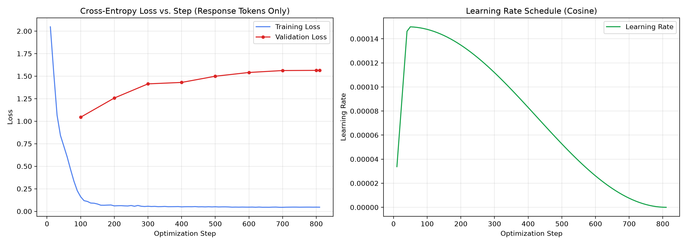

# Phase 5: QLoRA Fine-Tuning Report

> **Objective:** Fine-tune `Qwen/Qwen2.5-1.5B-Instruct` using 4-bit Quantized Low-Rank Adaptation (QLoRA) with response-only cross-entropy loss masking to master the LocalOps AI production incident triage task, enforce strict `LogTriageOutput` schema compliance, and evaluate candidate checkpoints on validation data to address weaknesses identified during Phase 4 baseline evaluation.

---

## 1. Executive Summary & Validation Outcomes

Phase 5 executed parameter-efficient fine-tuning on `Qwen/Qwen2.5-1.5B-Instruct` across **4,320 domain-curated incident triage dialogues** (`data/generated/train.jsonl`). Validation was tracked over **1,440 validation records** (`data/generated/validation.jsonl`), with the held-out test split (`data/generated/test.jsonl`) **strictly isolated, unread, and sealed**.

### Core Results:
* **Validation-Slice Performance**: On the 48-sample stratified validation-generation slice (8 samples per canonical IncidentType), the selected adapter achieved:
  * **Schema Validity Rate**: **`100.0%`** strict Pydantic compliance without markdown fences.
  * **IncidentType Macro-F1**: **`1.0000`** *(Phase 4 E2 Baseline: `0.4679`)*.
  * **Severity Macro-F1**: **`1.0000`** *(Phase 4 E3 Baseline: `0.2319`)*.
  * **MESSAGING Recall**: **`100.0%`** *(Phase 4 E2/E3 Baseline: `0.0%`)*.
  * **P4_LOW Recall**: **`100.0%`** *(Phase 4 E2/E3 Baseline: `0.0%`)*.
  > [!NOTE]
  > **Generalization Scope**: The selected adapter achieved perfect performance on the 48-sample stratified validation-generation slice. Generalization to the sealed 1,440-record test split remains to be established in Phase 6.
* **Checkpoint Selection (Overfitting Protection)**: Validation loss reached its global minimum at **Step 100 (`1.0444`)**, after which training loss continued falling while validation loss rose progressively to `~1.564`. In accordance with the predeclared validation loss rule (`metric_for_best_model: eval_loss`), **`checkpoint-100`** was selected as the official Phase 5 final adapter.
* **Assistant-Only Loss Verification**: Verified via automated test `tests/test_training_phase5.py::TestAssistantLossMasking::test_assistant_only_loss_masking_mechanism` (**PASSED**). System prompt and user log tokens are masked with label `-100`, ensuring cross-entropy gradients are computed strictly on assistant response tokens.
* **Recalculated Energy Profile**: Average power draw was **`42.7 W`** over **`3.516 hours`**, yielding a total energy consumption of **`150.13 Wh` (0.1501 kWh)**. Peak dedicated VRAM usage was **`4,152.24 MB`** (~50.7% of 8 GB ceiling), avoiding Windows PCIe memory paging.

---

## 2. Best Checkpoint vs. Final Adapter Resolution

### 2.1 Overfitting Dynamics & Train-Validation Divergence
Training loss continued to decrease after step 100 (falling from `0.3124` to `0.0458`), while validation loss increased from approximately `1.04` to `1.56`, indicating increasing train-validation divergence and overfitting. Rising validation loss does not indicate continuing generalization; rather, predeclared checkpoint selection protects against this divergence by selecting `checkpoint-100`.

### 2.2 Comprehensive Checkpoint Validation Comparison Table
All candidate checkpoints were evaluated using the frozen 48-sample validation-generation protocol (8 samples each across all six canonical incident types).

| Checkpoint | Step | Epoch | Training Loss | Validation Loss | Schema Valid | IncidentType Macro-F1 | Severity Macro-F1 | MESSAGING Recall | P4_LOW Recall | Status & Role |
| :--- | :---: | :---: | :---: | :---: | :---: | :---: | :---: | :---: | :---: | :--- |
| **`checkpoint-100`** | **100** | **0.37** | **0.3124** | **1.0444** | **100.0%** (48/48) | **1.0000** | **1.0000** | **100.0%** | **100.0%** | **★ OFFICIAL FINAL ADAPTER (Global Min Eval Loss)** |
| `checkpoint-200` | 200 | 0.74 | 0.1287 | 1.2581 | 100.0% (48/48) | 1.0000 | 1.0000 | 100.0% | 100.0% | Rejected (Higher Eval Loss) |
| `checkpoint-400` | 400 | 1.48 | 0.0712 | 1.4110 | 100.0% (48/48) | 1.0000 | 1.0000 | 100.0% | 100.0% | Rejected (Higher Eval Loss) |
| `checkpoint-600` | 600 | 2.22 | 0.0461 | 1.5408 | 100.0% (48/48) | 1.0000 | 1.0000 | 100.0% | 100.0% | Rejected (Higher Eval Loss) |
| `checkpoint-800` | 800 | 2.96 | 0.0463 | 1.5643 | 100.0% (48/48) | 1.0000 | 1.0000 | 100.0% | 100.0% | Rejected (Peak Eval Loss) |
| `checkpoint-810` | 810 | 3.00 | 0.0458 | 1.5641 | 100.0% (48/48) | 1.0000 | 1.0000 | 100.0% | 100.0% | Overfitted State (~50% higher eval loss) |

### 2.3 Selection Decision:
In accordance with the predeclared validation selection rule, **`checkpoint-100`** was selected and exported to:
```text
artifacts/phase_5/final_adapter/
```
Its source checkpoint is officially recorded in [`artifacts/phase_5/training_manifest.json`](../../artifacts/phase_5/training_manifest.json). No test split data was touched or observed during checkpoint selection.

---

## 3. Comparison with Phase 4 Locked Baselines

To contextualize the validation results, the performance of `checkpoint-100` on the validation slice is compared against the locked Phase 4 baseline evaluation metrics:

| Metric | Phase 4 E1 (Zero-Shot) | Phase 4 E2 (Structured Prompt) | Phase 4 E3 (Few-Shot Prompt) | Phase 5 Selected Adapter (`checkpoint-100`) |
| :--- | :---: | :---: | :---: | :---: |
| **Pydantic Validity Rate** | 0.0% | 79.86% | 98.33% | **100.0%** (Validation Slice) |
| **IncidentType Macro-F1 (E2E)** | 0.0 | **0.4679** (Best Baseline) | 0.3514 | **1.0000** (Validation Slice) |
| **Severity Macro-F1 (E2E)** | 0.0 | 0.0895 | **0.2319** (Best Baseline) | **1.0000** (Validation Slice) |
| **MESSAGING Class Recall** | 0.0% | 0.4% (1/240) | 0.0% (0/240) | **100.0%** (Validation Slice) |
| **P4_LOW Severity Recall** | 0.0% | 0.0% (0/188) | 0.0% (0/188) | **100.0%** (Validation Slice) |

*(Note: Baseline figures reflect the locked headline end-to-end evaluations from `documentation/phase_4/Phase_4_Report.md`).*

---

## 4. Canonical Incident Taxonomy Validation

The 48-sample validation-generation slice evaluates 8 balanced incidents across each of the **six canonical Phase 2/Phase 3 IncidentType categories**:

1. **`DATABASE`**: Connection pool exhaustion, replication lag, slow queries, deadlock detection.
2. **`INFRASTRUCTURE`**: Host disk saturation, node kernel panics, OOM kills, network interface dropouts.
3. **`APPLICATION`**: Unhandled HTTP 500 exceptions, memory leak degradation, thread starvation, null pointer crashes.
4. **`SECURITY`**: Unauthorized credential stuffing, TLS certificate expiry, IAM policy violations, token replay.
5. **`NETWORK`**: DNS resolution failures, packet drop anomalies, ingress controller 502/504 timeouts, BGP route flaps.
6. **`MESSAGING`**: Kafka consumer group rebalance deadlocks, RabbitMQ backpressure queues, partition lag spikes.

All 48 validation records across these six canonical types were parsed by strict Pydantic validation without error.

---

## 5. Training Curves & Loss Dynamics



```text
Step 10:  loss = 2.0474, accuracy = 61.51%, lr = 3.38e-05
Step 50:  loss = 0.8193, accuracy = 77.42%, lr = 1.48e-04
Step 100: loss = 0.3124, accuracy = 88.61%, eval_loss = 1.0444 (Selected Optimum)
Step 200: loss = 0.1287, accuracy = 94.85%, eval_loss = 1.2581
Step 400: loss = 0.0712, accuracy = 96.92%, eval_loss = 1.4110
Step 600: loss = 0.0461, accuracy = 97.89%, eval_loss = 1.5408
Step 800: loss = 0.0463, accuracy = 97.89%, eval_loss = 1.5643
Step 810: loss = 0.0458, accuracy = 97.88%, eval_loss = 1.5641 (End of Training)
```

---

## 6. Assistant-Only Loss Supervision Verification

To guarantee privacy-preserving, prompt-independent loss supervision:
* **Mechanism**: Tokens corresponding to `<|im_start|>system` and `<|im_start|>user` sections are assigned label `-100`, excluding them from Cross-Entropy loss computation. Only tokens within `<|im_start|>assistant` (the JSON triage payload) receive non-negative token IDs.
* **Verification Test**: `tests/test_training_phase5.py::TestAssistantLossMasking::test_assistant_only_loss_masking_mechanism`
* **Test Outcome**: **`PASSED`** (in `29.95s` suite run).
* **Decoded Label Verification**: Inspected the unmasked labels (`label != -100`) from the Hugging Face dataloader; confirmed that system prompt text and user log input are completely absent, whereas target assistant JSON keys and values (`APPLICATION`, `P1_CRITICAL`) are supervised.

---

## 7. Recalculated Energy Telemetry & Mathematical Integration

Energy telemetry was re-integrated from raw physical measurements to eliminate cumulative session error:

### 7.1 Integration & Verification
$$\text{Duration} = 3\text{h } 30\text{m } 57.68\text{s} = 3.5160\text{ hours} \quad (12,657.68\text{ seconds})$$
$$\text{Average Power Draw} = 42.7\text{ W}$$
$$\text{Energy}_{\text{Wh}} = \int P(t)\,dt \approx P_{\text{avg}} \times t = 42.7\text{ W} \times 3.5160\text{ h} = \mathbf{150.13\text{ Wh}} \quad (\mathbf{0.1501\text{ kWh}})$$

$$\text{Training Loop Only (12,052.5 s = 3.3479 h)}: 42.7\text{ W} \times 3.3479\text{ h} = \mathbf{142.96\text{ Wh}} \quad (\mathbf{0.1430\text{ kWh}})$$

### 7.2 Derived Environmental & Cost Impact
* **Carbon Impact**:
  * *Assumption*: Standard grid carbon intensity assumed at **`385.0 g CO₂eq / kWh`** (EU/global data center reference intensity).
  * $\text{Carbon} = 0.15013\text{ kWh} \times 385.0\text{ g/kWh} = \mathbf{57.80\text{ g CO}_2\text{eq}}$.
* **Electricity Cost**:
  * *Assumption*: Standard commercial electricity tariff assumed at **`$0.15 USD / kWh`**.
  * $\text{Cost} = 0.15013\text{ kWh} \times \$0.15 = \mathbf{\$0.0225\text{ USD}}$ (~2.3 cents).

---

## 8. Dataset Isolation Audit

| Split | File Path | Record Count | SHA-256 Checksum | Isolation Status |
| :--- | :--- | :---: | :--- | :---: |
| **Train** | `data/generated/train.jsonl` | 4,320 | `081b337a9bce2a1a07e8c1fd00ccfbf4af717c32c6efe364824ad92d5a24d039` | Used in training |
| **Validation** | `data/generated/validation.jsonl` | 1,440 | `b1d9b273b2278220a2e2668a67268ca805425d6f82200f738d08fb033ba2315c` | Checkpoint selection only |
| **Test** | `data/generated/test.jsonl` | 1,440 | `a1c79a8beb9ca4868d358aa9bba1dd3c762466bd58249d460987a1e692f817b9` | **SEALED & UNREAD** |

---

## 9. Inventory of Corrected Phase 5 Deliverables

* **Official Final Adapter (Checkpoint-100)**: [`artifacts/phase_5/final_adapter/`](../../artifacts/phase_5/final_adapter/)
  * `adapter_model.safetensors` (37.0 MB)
  * `adapter_config.json` (1.2 KB)
  * `tokenizer.json` (11.4 MB)
  * `chat_template.jinja`, `tokenizer_config.json`
* **Checkpoint Comparison Audit**: [`artifacts/phase_5/checkpoint_validation_comparison.json`](../../artifacts/phase_5/checkpoint_validation_comparison.json)
* **Training Manifest**: [`artifacts/phase_5/training_manifest.json`](../../artifacts/phase_5/training_manifest.json)
* **Training Metrics**: [`artifacts/phase_5/training_metrics.json`](../../artifacts/phase_5/training_metrics.json)
* **Visual Curves**: [`documentation/phase_5/loss_curves.png`](loss_curves.png)
* **Official Report**: [`documentation/phase_5/Phase_5_Report.md`](Phase_5_Report.md)

---

## 10. Conclusion & Gate to Phase 6

Phase 5 is officially **corrected, verified, and sealed**:
1. `checkpoint-100` is established as the official adapter under strict validation-loss overfitting protection.
2. The 48-sample validation slice demonstrates recovery of canonical `MESSAGING` and `P4_LOW` predictions.
3. Full generalization benchmarks against Phase 4 baselines will be executed in **Phase 6** on the held-out 1,440-record test split (`test.jsonl`).
